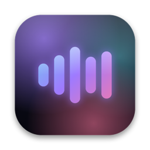
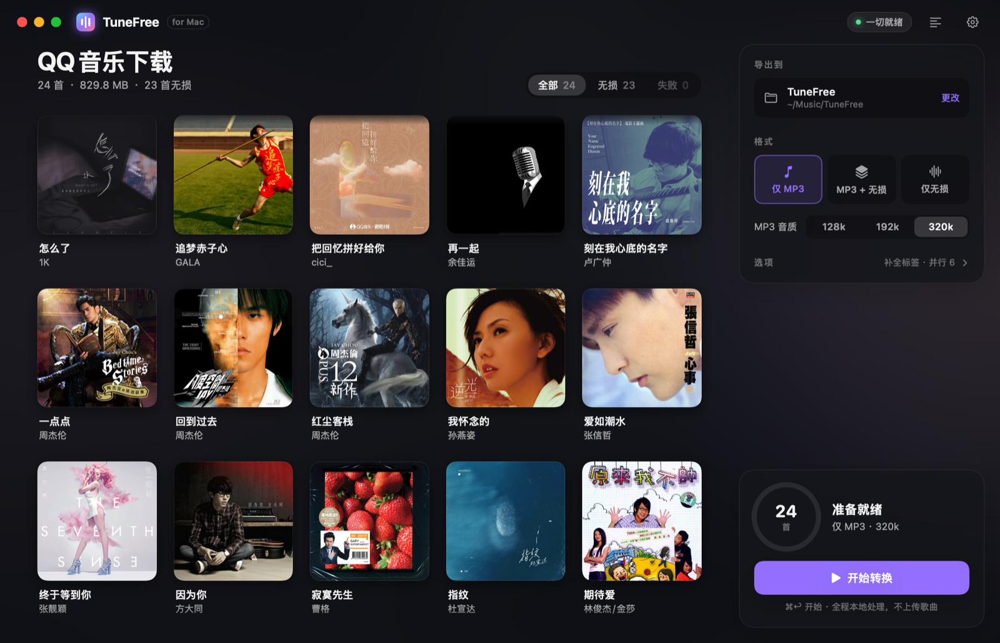

<p align="center">
  
</p>

<h1 align="center">TuneFree for Mac</h1>

<p align="center">
  <b>Turn encrypted QQ Music downloads (<code>.mflac</code> / <code>.mgg</code>) into <code>MP3</code> / <code>FLAC</code> that any player can open.</b><br>
  Native macOS app · decrypts locally · QQ Music doesn't need to be running
</p>

<p align="center">
  <a href="https://github.com/Dora-z/TuneFree_Mac/releases/latest"></a>
  
  
  <a href="LICENSE"></a>
</p>

<p align="center">
  <a href="https://github.com/Dora-z/TuneFree_Mac/releases/latest"><b>⬇️ Download</b></a> · <a href="README.md">中文</a>
</p>

<p align="center">
  
</p>

## What it does

Some tracks downloaded in QQ Music come in encrypted containers that only QQ Music can play:

| Extension | What it really is |
|---|---|
| `.mflac` / `.mflac0` | encrypted `FLAC` (lossless) |
| `.mgg` / `.mgg1` / `.mggl` | encrypted `OGG` |
| `.qmcflac` / `.qmcogg` / `.qmc0` / `.qmc3` | older client formats |

TuneFree restores them to plain audio on your own Mac and converts them to `MP3`:

```
.mflac / .mgg  ──decrypt──▶  .flac / .ogg  ──encode──▶  .mp3
```

## Three steps

1. From [Releases](https://github.com/Dora-z/TuneFree_Mac/releases/latest), download the DMG for your chip and drag TuneFree into Applications
   - Apple silicon (M1 / M2 / M3 / M4…): `TuneFree-…-arm64.dmg`
   - Intel: `TuneFree-…-x86_64.dmg`
   - Not sure? Apple menu → About This Mac: "Chip: Apple …" means Apple silicon, "Processor: Intel …" means Intel
2. Open TuneFree and drop the folder with your encrypted songs onto the window (or click "打开 QQ音乐缓存" to load QQ Music's download folder)
3. Pick output format and bitrate, press **Start**, then "Open in Finder" when it's done

The app bundles its own Python runtime and ffmpeg — **nothing else to install**.

## Features

- 🎵 Batch processing, walks subfolders
- 🎚 MP3 only / MP3 + lossless FLAC / lossless only; MP3 at 128k, 192k or 320k
- 🏷 **Complete tags**: looks the song up on QQ Music by its ID — title, all artists, album, year, track number, genre, label — and embeds the **800×800 album cover** and **lyrics** (optional `.lrc` file for synced lyrics). A result is only used if title, artist and duration match the file; otherwise the file's own tags and the `Artist-Title` file name are used
- ✅ Optional container checks (OGG page CRC, FLAC STREAMINFO, MP3 frame headers)
- ⚡ Skips songs already converted; parallel encoding
- 📋 Live per-track status, failure reasons with suggestions, full log
- 🔔 Automatic update check (prompts and downloads the right installer for your chip; turn it off in Settings ⌘,, or check manually via the app menu)
- 📖 First-launch guide with usage notes and disclaimer, available later from the Help menu

## Requirements

- macOS 14 (Sonoma) or later
- Apple silicon or Intel Macs (separate `arm64` / `x86_64` downloads)
- Files in the newer `musicex` layout need QQ Music to have been **logged in on this Mac** (it doesn't need to be running)

## First launch

The app isn't notarized, so macOS blocks it the first time: in Applications, **right-click TuneFree → Open → Open**. If it still won't open, go to System Settings → Privacy & Security and click "Open Anyway". You only do this once.

## FAQ

**"Can't get key" / "login expired"** — `musicex` files don't carry their key. TuneFree reads QQ Music's local login state and asks QQ Music's official API for that song's key. Log in to QQ Music once, then press "再次转换" (Convert again). Files forwarded from someone else can't be decrypted, because the key is bound to the account that downloaded them.

**Does it upload my music?** No. It talks to QQ Music's official API for two things: the key for `musicex` files (required to decrypt), and tag lookup by song ID (cover, album, lyrics; no login). Turn off "联网补全标签" (online tags) under Advanced, or pass `--no-online-tags`, to skip the tag lookup.

## Build from source

Needs only the Xcode Command Line Tools (`xcode-select --install`):

```bash
git clone https://github.com/Dora-z/TuneFree_Mac.git
cd TuneFree_Mac/macos
bash app/build.sh                 # both chips → dist/<arch>/TuneFree.app and dist/TuneFree-<version>-<arch>.dmg
bash app/build.sh --arch x86_64   # Intel only (cross-built via Rosetta on Apple silicon)
```

CLI usage, the `--json` event protocol and the Python API are documented in [macos/README.md](macos/README.md) (Chinese).

## How it works

No process injection: the algorithms are reimplemented locally. The file footer yields the ekey → TC-TEA derives the key → QMC2's Map / RC4 cipher restores the audio; legacy QMC1 uses a fixed XOR table. Decryption runs at ~400–480 MB/s, then ffmpeg encodes.

## Disclaimer

For **personal study and use** only: decrypt music you legally downloaded, to play on devices you own. Do not use it for redistribution or commercial purposes. You are responsible for how you use it.

## License & credits

[MIT License](LICENSE). The license covers the code; it does not change the usage limits above.

- Based on [zksbx/TuneFree](https://github.com/zksbx/TuneFree) (the Windows version)
- [FFmpeg](https://ffmpeg.org/) — audio encoding
- [Unlock Music](https://github.com/unlock-music/unlock-music) — format research
- [PyInstaller](https://pyinstaller.org/) — bundling the Python runtime
