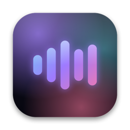
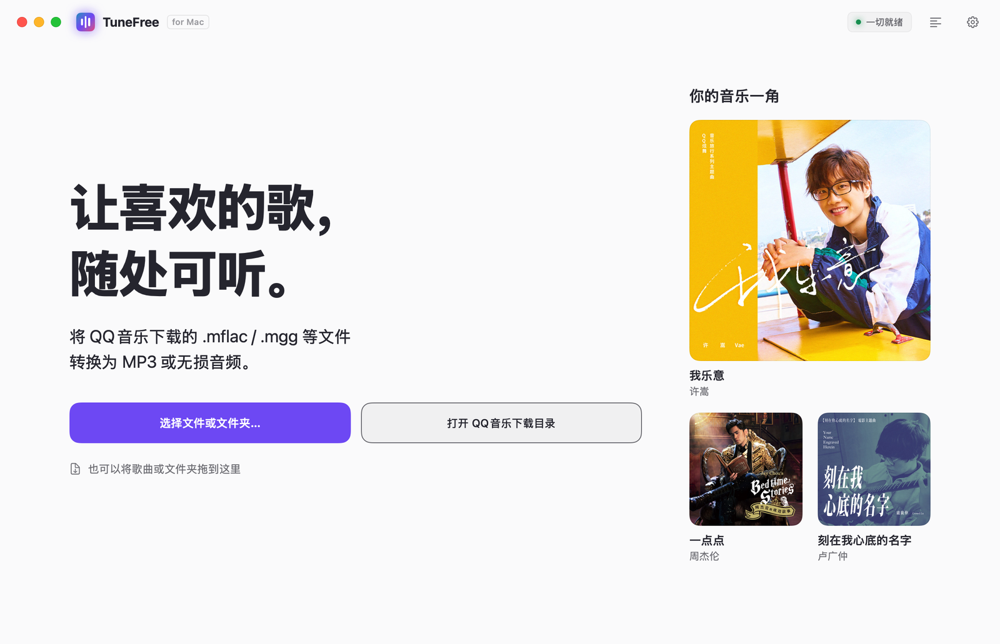
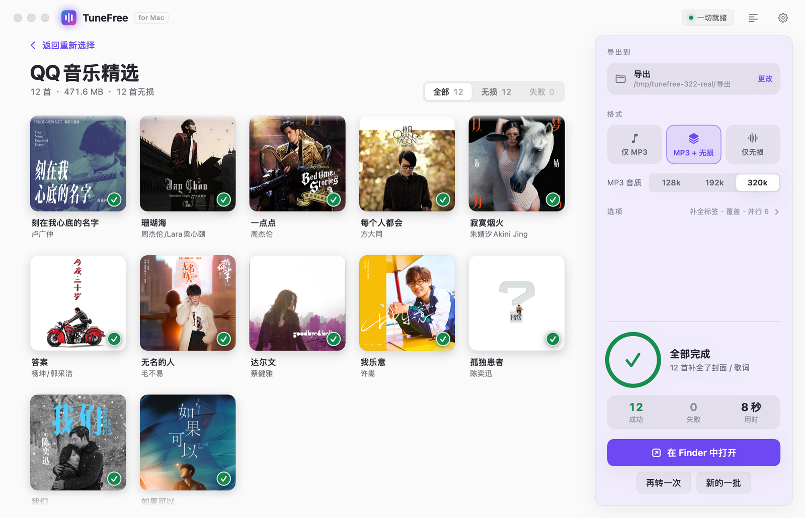

<p align="center">
  
</p>

<h1 align="center">TuneFree for Mac</h1>

<p align="center">
  <b>把 QQ音乐下载的加密歌曲（<code>.mflac</code> / <code>.mgg</code>）变成任何播放器都能放的 <code>MP3</code> / <code>FLAC</code>。</b><br>
  原生 macOS 应用 · 本机离线解密 · 不需要 QQ音乐在运行
</p>

<p align="center">
  <a href="https://github.com/Dora-z/TuneFree_Mac/releases/latest"></a>
  
  
  <a href="LICENSE"></a>
</p>

<p align="center">
  <a href="https://github.com/Dora-z/TuneFree_Mac/releases/latest"><b>⬇️ 下载最新版</b></a> · <a href="README.en.md">English</a>
</p>

<p align="center">
  
</p>

**3.2.2** 统一了首页、工作台和设置页的卡片与控件圆角，小按钮保留清晰的轮廓。[查看发布说明](https://github.com/Dora-z/TuneFree_Mac/releases/tag/v3.2.2)

## 它解决什么问题

QQ音乐下载的部分歌曲是加密容器，只有 QQ音乐自己能放：

| 扩展名 | 实际内容 |
|---|---|
| `.mflac` / `.mflac0` | 加密的 `FLAC`（无损） |
| `.mgg` / `.mgg1` / `.mggl` | 加密的 `OGG` |
| `.qmcflac` / `.qmcogg` / `.qmc0` / `.qmc3` | 老版本客户端的加密格式 |

拷到车机、MP3、手机或别的播放器里就是「格式不支持」。TuneFree 在你自己的 Mac 上把它们还原成普通音频，再转成 `MP3`：

```
.mflac / .mgg  ──解密──▶  .flac / .ogg  ──转码──▶  .mp3
```

## 三步就能用

1. 到 [Releases](https://github.com/Dora-z/TuneFree_Mac/releases/latest) 下载对应芯片的安装包，打开后把 TuneFree 拖进「应用程序」
   - Apple 芯片（M1 / M2 / M3 / M4…）：`TuneFree-…-arm64.dmg`
   - Intel 芯片：`TuneFree-…-x86_64.dmg`
   - 不确定的话：点屏幕左上角的苹果菜单 →「关于本机」，「芯片」写着 Apple 就是 Apple 芯片，「处理器」写着 Intel 就是 Intel
2. 打开 TuneFree，把歌曲文件或文件夹拖进窗口，也可点「选择文件或文件夹…」或「打开 QQ音乐下载目录」
3. 选好输出格式和音质，点 **开始转换**，完成后点「在 Finder 中打开」

App 里自带 Python 运行时和 ffmpeg，**不需要另外安装任何东西**。

<p align="center">
  
</p>

## 功能

- 🖼 **封面墙**：选好文件夹就按歌曲 ID 查出每首歌的专辑封面铺满窗口（第一次要联网，之后走本机缓存），转换进度直接画在封面上
- 💿 **首页唱片预览**：从 QQ 音乐下载目录抽样展示封面，首页活跃时定期轮换
- 🎵 批量处理，自动查找子文件夹
- 🎚 三种输出：仅 MP3 / MP3 + 无损 FLAC / 仅无损；MP3 可选 128k、192k、320k
- 🏷 **自动补全标签**：按歌曲 ID 向 QQ音乐查歌名、全部歌手、专辑、年份、曲序、流派、唱片公司，
  嵌入 **800×800 专辑封面** 和 **歌词**；可另存 `.lrc` 同步歌词。查到的结果要和文件的歌名、歌手、时长对得上才会用（按文件自带的歌曲 ID 查到、时长一致时，歌手改名 / 别名或标签里的错字不影响），查不到就用文件自带标签 +「歌手-歌名」文件名
- ✅ 可选容器校验：OGG 逐页 CRC、FLAC STREAMINFO、MP3 帧头
- ⚡ 已转好的歌下次自动跳过；并行转码，默认用一半的 CPU 核心（可在右侧「选项」里调）
- 📋 实时显示每首歌的状态，失败给出原因和处理建议，附完整日志
- ⚙️ 设置页（右上角齿轮或 ⌘,）：版本号、仓库地址、检查更新、外观、完成提醒、运行环境、封面缓存
- 🌗 浅色 / 深色模式自动跟随系统，也可以在设置里固定
- 🔔 自动检查更新 + **一键更新**：有新版本时点「立即更新」，App 自己下载对应芯片的安装包、用 GitHub 公布的 SHA-256 校验、替换旧版并重启，**不用再去系统设置里允许**（可在设置 ⌘, 里关闭自动检查；也可从菜单「检查更新…」手动查）
- 📖 首次打开附使用说明与免责声明，之后可从「帮助」菜单再次查看

<p align="center">
  
</p>

## 系统要求

- macOS 14 (Sonoma) 或更新
- Apple 芯片或 Intel 芯片的 Mac 都支持（分别下载 `arm64` / `x86_64` 安装包）
- 新版 QQ音乐下载的 `musicex` 格式需要这台 Mac **登录过 QQ音乐**（不用开着，见下方说明）

## 第一次打开

App 没有经过 Apple 公证，第一次打开会提示「无法验证开发者」：

1. 打开「应用程序」，在 TuneFree 上**右键 → 打开**
2. 弹窗里再点一次「打开」

还是打不开：系统设置 → 隐私与安全性 → 往下翻，点「仍要打开」。只需要做一次。

以后的更新请用 App 里的「立即更新」（2.1.3-mac.12 起）：App 自己下载的安装包不会被系统拦，不用再去设置里允许；
更新用的临时文件用完即删，新版万一打不开会自动恢复到旧版；一键更新不成功时会自动改用浏览器下载（原来的手动更新方式）。
如果是从网页重新下载 DMG 手动覆盖安装，系统还是会再拦一次。

## 常见问题

### 提示「取不到密钥」或「登录态过期」

新版 QQ音乐下载的歌，文件里**不带密钥**（列表里标着 `musicex`）。TuneFree 会读取本机 QQ音乐的登录状态，向 QQ音乐官方接口取这首歌的密钥。

打开 QQ音乐登录一次，再回到 TuneFree 点「再次转换」即可。别人转发给你的这类文件解不开，因为密钥绑定的是下载它的账号。

### QQ音乐是 App Store 版：授权弹窗一闪而过，歌全部解密失败

App Store 版 QQ音乐是沙盒应用，歌曲和登录信息都在它自己的容器里。macOS 对「访问其他 App 的数据」的授权弹窗
只在发起读取的进程存在时有效，常常一闪而过来不及点。请打开 **系统设置 → 隐私与安全性 → 完全磁盘访问权限**，
打开 TuneFree 的开关（列表里没有就点「+」从「应用程序」里添加）。TuneFree 检测到这种情况时，顶部会出现提示条，
点「打开系统设置」可以直接跳过去，开好后回到 TuneFree 会自动重新检查。

### 弹窗说 TuneFree 想访问「下载」「桌面」或「文稿」

点「允许」。拒绝过的话，到 系统设置 → 隐私与安全性 → 文件与文件夹 里重新打开。

### 有少数歌转不出来

点结果卡片里的「问题」查看原因，或用右上角按钮（⌘L）打开日志。常见原因：文件没下载完（0 字节）、文件损坏、不是音频（比如 `.mmp4` 视频）。

### 联网吗？会上传我的歌吗？

不上传任何歌曲。会连 QQ音乐官方接口做两件事：

- 给 `musicex` 格式的歌要密钥（解密必需）；
- 补全标签：按歌曲 ID 查歌名、专辑、封面、歌词（只发「这是哪首歌」，不需要登录）。

不想联网补标签，在右侧「选项」里关掉「联网补全标签」即可（命令行加 `--no-online-tags`），载入时也就不再联网查封面，其他照常。

### 转出来的歌没有封面 / 专辑

联网补全只对能确认身份的歌生效：新版 QQ音乐下载的歌文件里带歌曲 ID，基本都能补上；老格式（列表里标着 V1 / QMC1）没有 ID，会用「歌手-歌名」文件名去搜，文件名不是这个格式就只能用本地标签。网络不通时也会退回本地标签，不影响转换。

## 从源码构建

只需要 Xcode 命令行工具（`xcode-select --install`）：

```bash
git clone https://github.com/Dora-z/TuneFree_Mac.git
cd TuneFree_Mac/macos
bash app/build.sh                 # 两种芯片都打 → dist/<架构>/TuneFree.app 与 dist/TuneFree-<版本>-<架构>.dmg
bash app/build.sh --arch x86_64   # 只打 Intel 版（在 Apple 芯片上会借助 Rosetta 交叉打包）
```

只想用命令行：

```bash
cd macos
python3 main.py -i ~/Music/QQ音乐下载 -o ~/Music/导出 -b 320k
python3 main.py --selftest
```

命令行参数、`--json` 事件协议和 Python API 见 [macos/README.md](macos/README.md)；界面与打包细节见 [macos/app/README.md](macos/app/README.md)。

## 原理

不注入 QQ音乐进程，算法在本地复现：解析文件尾部拿到 ekey → TC-TEA 派生密钥 → QMC2 的 Map / RC4 密码把音频还原；老格式 QMC1 用固定异或表。解密在 600 MB/s 以上（Map / RC4 两种都是），一首歌不到 0.1 秒，时间主要花在 ffmpeg 转码。

## 项目结构

```
TuneFree_Mac/
├── macos/
│   ├── app/                 SwiftUI 图形界面 + 打包脚本（build.sh）
│   ├── tunefree_backend/    解密 / 转码后端（纯 Python 标准库）
│   ├── main.py              命令行入口
│   ├── ship/                命令行版发布包（无界面）
│   ├── tests/               单元 / 集成测试
│   ├── tools/               调试样本生成
│   └── examples/            后端接入示例
├── assets/                  README 用图
└── LICENSE
```

## 免责声明

本工具仅供**个人学习交流**使用，用于解密本机已合法下载的音乐文件，方便在自己拥有的设备上播放。

请勿用于传播、二次分发或商业用途。使用产生的一切法律责任由使用者自行承担。

## 许可与致谢

代码以 [MIT License](LICENSE) 开源。MIT 授权的是代码，不改变上面免责声明对使用场景的限制。

- 基于 [zksbx/TuneFree](https://github.com/zksbx/TuneFree)（Windows 版，作者 曾困睡不醒）。
  从 3.0.0 起使用本项目自己的版本号（之前的 `2.1.3-mac.N` 沿用了原仓库的版本号）
- [FFmpeg](https://ffmpeg.org/) — 音频转码
- [Unlock Music](https://github.com/unlock-music/unlock-music) — 加密格式的解析经验
- [PyInstaller](https://pyinstaller.org/) — 打包 Python 运行时
